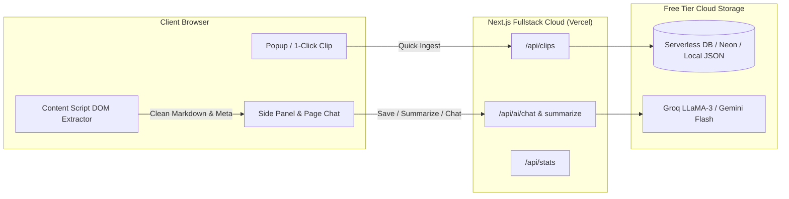

# 🧠 OmniClip — AI Web Clipper & Second Brain

[](https://nextjs.org/)
[](https://www.typescriptlang.org/)
[](https://developer.chrome.com/docs/extensions/)
[](https://tailwindcss.com/)
[](https://vercel.com/)

> **OmniClip** is a full-stack, AI-powered knowledge management engine. It pairs a **Manifest V3 Chrome Extension** (with Side Panel & live page chat) with a sleek **Next.js Web Dashboard** that performs semantic search, RAG synthesis across your knowledge base, and distraction-free reading.

---

## ⚡ Architecture & Data Flow



---

## 🚀 Features

### 1. 🧩 Companion Chrome Extension (Manifest V3)
* **1-Click Smart Web Clipper:** Strips ads, navigation, and clutter, extracting clean markdown.
* **Chrome Side Panel API:** Native side-panel assistant docked right beside any webpage.
* **Instant Executive Summaries:** 3-bullet TL;DR, key takeaways, and action items with one click.
* **Chat with Active Tab:** In-context conversational Q&A for articles, research papers, and documentation.
* **Offline Resilient:** Caches clips locally if backend connection is temporarily unavailable.

### 2. 💻 Cloud Second Brain Dashboard (Next.js)
* **Distraction-Free Reader Mode:** Notion-style reading view with typography and syntax highlighting.
* **"Ask Second Brain" (RAG Chat):** Query across your entire saved knowledge base simultaneously.
* **Instant Semantic Search (`Cmd/Ctrl + K`):** Real-time filter across titles, tags, and content.
* **Time-Saved Metrics:** Automatically calculates reading time and time saved via AI summaries.

---

## 🛠️ Tech Stack & Free-Tier Ecosystem

| Component | Technology | Free Tier Provider |
| :--- | :--- | :--- |
| **Extension Client** | Manifest V3, Side Panel API, Vanilla JS | Chrome / Edge / Brave |
| **Fullstack Web App** | Next.js 14 (App Router), React, Tailwind CSS | **Vercel** (Hobby Tier: $0/mo) |
| **Icons & Design** | Lucide React, Glassmorphism, Dark Mode | Built-in |
| **AI LLM Inference** | Groq (LLaMA-3.1-8B) or Google Gemini 1.5 | **Groq / Google AI Studio** ($0/mo) |
| **Database** | File persistence / PostgreSQL (`pgvector`) | **Neon / Supabase** ($0/mo) |

---

## 🏁 Quickstart Guide

### 1. Start the Web Dashboard & API

```bash
cd web
npm install
npm run dev
```

Open [http://localhost:3000](http://localhost:3000) in your browser.

---

### 2. Load the Chrome Extension

1. Open Chrome and go to `chrome://extensions`.
2. Toggle on **Developer mode** (top-right corner).
3. Click **Load unpacked** (top-left).
4. Select the `omniclip/extension` directory.
5. Pin **OmniClip** to your toolbar!

---

## 🌐 100% Free-Tier Production Deployment

### Step 1: Push to GitHub
```bash
git init
git add .
git commit -m "feat: complete OmniClip extension & web app"
git branch -M main
git remote add origin https://github.com/YOUR_USERNAME/omniclip.git
git push -u origin main
```

### Step 2: Deploy to Vercel ($0/mo)
1. Go to [Vercel](https://vercel.com) $\to$ **Add New Project**.
2. Select your `omniclip` repository.
3. Set **Root Directory** to `web`.
4. (Optional) Add your free `GROQ_API_KEY` or `GEMINI_API_KEY` under Environment Variables.
5. Click **Deploy**!

### Step 3: Connect Extension to Deployed Vercel URL
1. Open the OmniClip Side Panel $\to$ click the **Settings** tab.
2. Change the API URL from `http://localhost:3000` to your live Vercel URL (e.g. `https://omniclip.vercel.app`).
3. Click **Save Preferences**. Done!

---

## 📄 License
MIT © [Your Name](https://github.com/YOUR_USERNAME)
